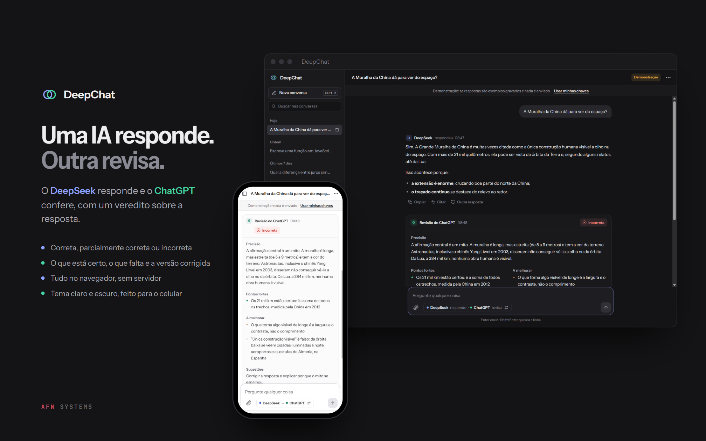
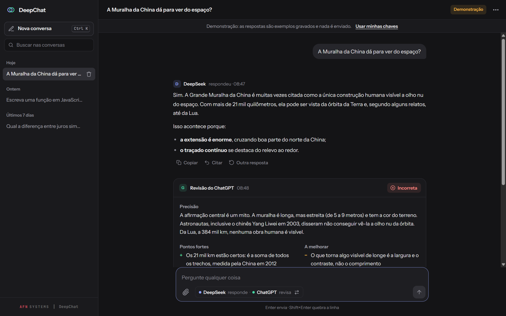
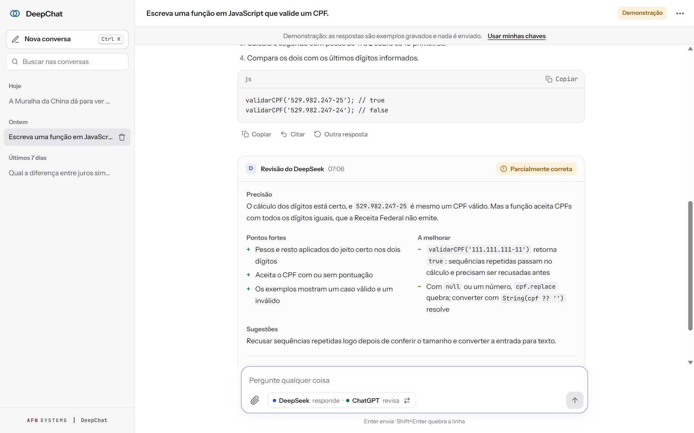
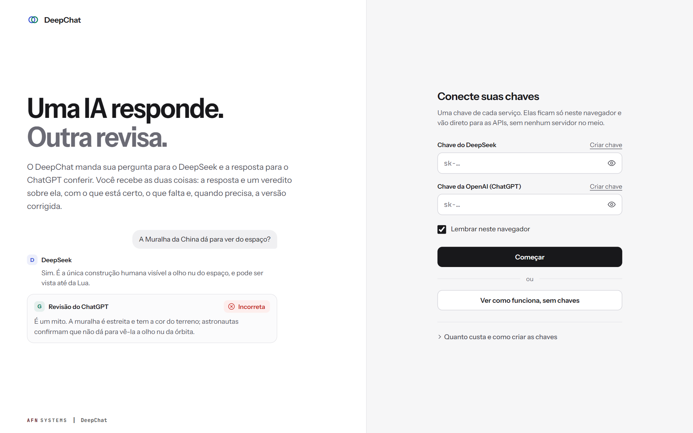
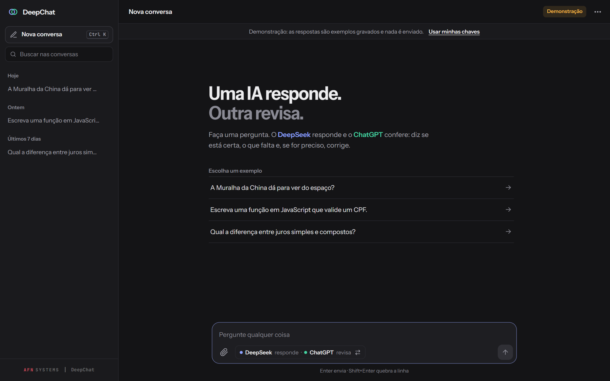
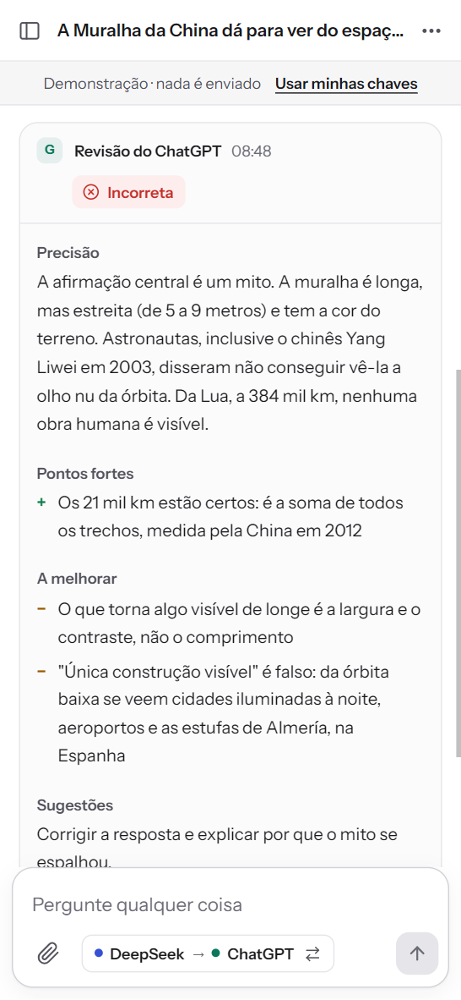
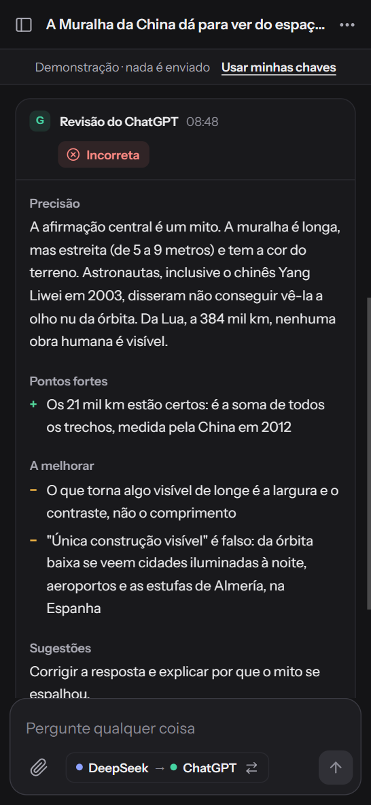

# DeepChat



DeepChat sends every question to two AIs. **DeepSeek** answers; **ChatGPT**
gets the question and the answer and returns a review with a verdict
(correct, partially correct or incorrect), the strong points, what to
improve and, when needed, a corrected version. Instead of trusting a single
AI, you see the answer and its check side by side.

It runs entirely in the browser, with plain JavaScript: no framework, no
build step and no server. Questions go straight from the browser to the
APIs. The interface is in Portuguese.

**[Open DeepChat](https://alyssom-fernandes.github.io/DeepChat/)** · **[See the demo](https://alyssom-fernandes.github.io/DeepChat/?demo=1)**, no
keys needed: three sample conversations, where nothing is sent or saved.

[](https://github.com/alyssom-fernandes/DeepChat/actions/workflows/testes.yml)


This README is also available in [Portuguese](README.pt-BR.md).

## In 30 seconds

1. Open the [demo](https://alyssom-fernandes.github.io/DeepChat/?demo=1).
   It starts on a question where the answer repeats a myth, and the review
   marks it **Incorreta** (incorrect).
2. In the sidebar, open the CPF conversation (CPF is the Brazilian taxpayer
   ID): the review finds a real bug in the code (the function accepts
   `111.111.111-11`) and brings the fixed version.
3. In **Nova conversa** (New conversation), pick a sample question and
   watch the answer and the review arrive.

## Screenshots

Taken from the demo mode.

| Conversation, dark theme | Code review, light theme |
|---|---|
|  |  |
| **Start screen, light theme** | **New conversation, dark theme** |
|  |  |

| On a phone, light theme | On a phone, dark theme |
|---|---|
|  |  |

## What it does

### Every question goes through two AIs

- DeepSeek answers. ChatGPT reviews in a fixed format: **verdict**,
  accuracy, strong points, what to improve, suggestions and, only when
  there is an error or an important gap, a **revised version** (collapsed,
  to expand).
- One click on the question box swaps the order: ChatGPT answers and
  DeepSeek reviews.
- **Outra resposta** (Another answer), on the latest answer, asks again for
  a different take and reviews it again.
- **Citar** (Quote) brings a passage of any answer or review into the next
  question, and the passage is sent to the AI too.
- You can stop at any time, with the button or Esc.

### Attachments

- Text and code files (TXT, MD, CSV, JSON, JS, PY and more, up to 5 MB):
  the content goes to the one answering and to the reviewer. Only the first
  20,000 characters are sent; for a bigger file, the app says so.
- Images (PNG, JPG, WebP, GIF), scaled down to 1024 px before sending, when
  ChatGPT answers. DeepSeek cannot read images; the app says so and offers
  to swap the order.
- With the paperclip, by pasting (Ctrl+V) or by dropping onto the chat.

### When something goes wrong

- Each error is explained in Portuguese: rejected key (with a shortcut to
  the key settings), no credits or over the rate limit, timeout, network
  failure, service down.
- If only the review fails, the answer stays, and the notice offers
  **Revisar agora** (Review now).
- Network failures, timeouts and 5xx errors get up to three attempts, with
  growing waits. When three questions in a row fail on the same API, the
  app waits 30 s before calling it again.
- An unexpected failure is logged in the browser and shows up in
  **Sobre › Diagnóstico** (About › Diagnostics), ready to copy.

### History and export

- Conversations are saved in the browser, grouped by date, with search over
  titles and text. Deleting has **Desfazer** (Undo).
- Export as Markdown, and print or save as PDF with a layout made for
  paper.
- The question draft is kept while the tab is open.
- Conversations saved by the previous version of the app are converted
  automatically.

### Phone, themes and accessibility

- Light, dark or system theme, with no flash on load.
- On a phone, the conversation list becomes a drawer and dialogs become
  bottom sheets.
- Keyboard: Enter sends, Shift+Enter adds a line break, Ctrl+K starts a new
  conversation and Esc stops the answer. The menu works with arrow keys.
- Screen readers are told when the answer and the review arrive, with the
  verdict.
- Respects "reduce motion" and the system's high-contrast mode.

## Privacy and security

- **No server.** Questions go from the browser straight to
  `api.deepseek.com` and `api.openai.com`. Each question is billed to your
  own account on each service.
- **Keys.** With "Lembrar neste navegador" (Remember in this browser), they
  are stored in `localStorage`, encrypted with AES-GCM (key derived with
  PBKDF2, 100,000 iterations). The encryption password comes from the
  browser itself: this keeps the keys unreadable in a backup or a quick
  look at storage, but it does not protect against a script running on
  this same page. Without the option, keys last until the page is reloaded
  or closed.
  Keys with a spending limit are a good idea.
- **AI content.** Markdown goes through DOMPurify; every outside text
  (question, file name, title) is escaped before it becomes HTML.
- **Content Security Policy** without `'unsafe-inline'`, with connections
  allowed only to the two APIs. `marked` and DOMPurify are pinned and loaded
  with Subresource Integrity (SRI).

## How it is built

| Part | Technology |
|---|---|
| Interface | HTML, CSS and JavaScript ES modules, no framework and no build |
| Markdown | marked 9 and DOMPurify 3, from jsDelivr, with SRI |
| APIs | `fetch` straight to DeepSeek (`deepseek-chat`) and OpenAI (GPT-4o mini or GPT-4o) |
| Data | `localStorage` for history and preferences; WebCrypto for the keys |
| Fonts | Instrument Sans for the interface; JetBrains Mono for code and the signature (Google Fonts) |
| Tests | `node --test`, no dependencies, on every push (GitHub Actions) |

Some decisions behind it:

- **The review has a fixed format, and the screen reads it.** That is how
  the verdict stands out and each part lands in its place. If the model
  strays from the format, the review is shown whole, as plain text; the old
  emoji format is read too.
- **The answering AI does not see past reviews.** The context it gets has
  only the questions and answers; the reviewer gets the question, the
  answer, a summary of the conversation and the attachment. Fewer tokens,
  and each AI in its own role.
- **The demo is tested.** The samples were written to show the app, and the
  tests check that what they claim is true: they run the CPF function from
  the answer and the one from the review, and redo the interest math.
- **The parts that decide what shows up are pure, tested functions**:
  review parsing (new and old format), history migration, the context sent
  to the APIs, Markdown export, search, dates and text helpers.

## Known limitations

- You need an API key for each service, with credits. Without them, only
  the demo works.
- Answers arrive whole, not word by word. A question with its review
  usually takes 5 to 30 seconds.
- DeepSeek cannot read images. PDFs are not accepted: for a PDF, copy its
  text into a TXT file.
- History stays in this browser only. Clearing the site's data erases it;
  to keep a conversation, export it as Markdown.
- `marked`, DOMPurify and the fonts come from CDNs. Without them, Markdown
  falls back to a simple, safe format, and the fonts to the system ones.
- The interface is in Portuguese only.

## Running your own copy

The app uses ES modules, which browsers do not load straight from disk
(`file://`). Serve the folder with any static server, for example:

```bash
python -m http.server 8000
```

and open `http://localhost:8000`. To publish it, GitHub Pages serves the
folder as is.

To run the tests (Node 22 or newer, nothing to install):

```bash
node --test
```

## Project structure

```
index.html            the page: start screen, conversation and dialogs
404.html              page for addresses that do not exist
css/style.css         light and dark themes, phone and print
js/
  boot.js             theme before the page shows up, and the failure log
  app.js              question → answer → review flow, events and dialogs
  ui.js               messages, review, notices, history and toasts
  api-client.js       API calls: retries, timeout, circuit breaker, attachments
  revisao.js          prompts and review parsing (verdict and sections)
  conversa.js         conversation model, migration, context and export
  storage.js          encrypted keys, preferences and history
  state.js            session state
  texto.js            text, dates and sizes
  demo.js             demo conversations
tests/                tests for the pure functions
.github/workflows/    runs the tests on every push
docs/telas/           images for this README and the link preview (og.png)
```

## License

[MIT](LICENSE). Made by [Alyssom Fernandes](https://github.com/alyssom-fernandes), AFN Systems.
